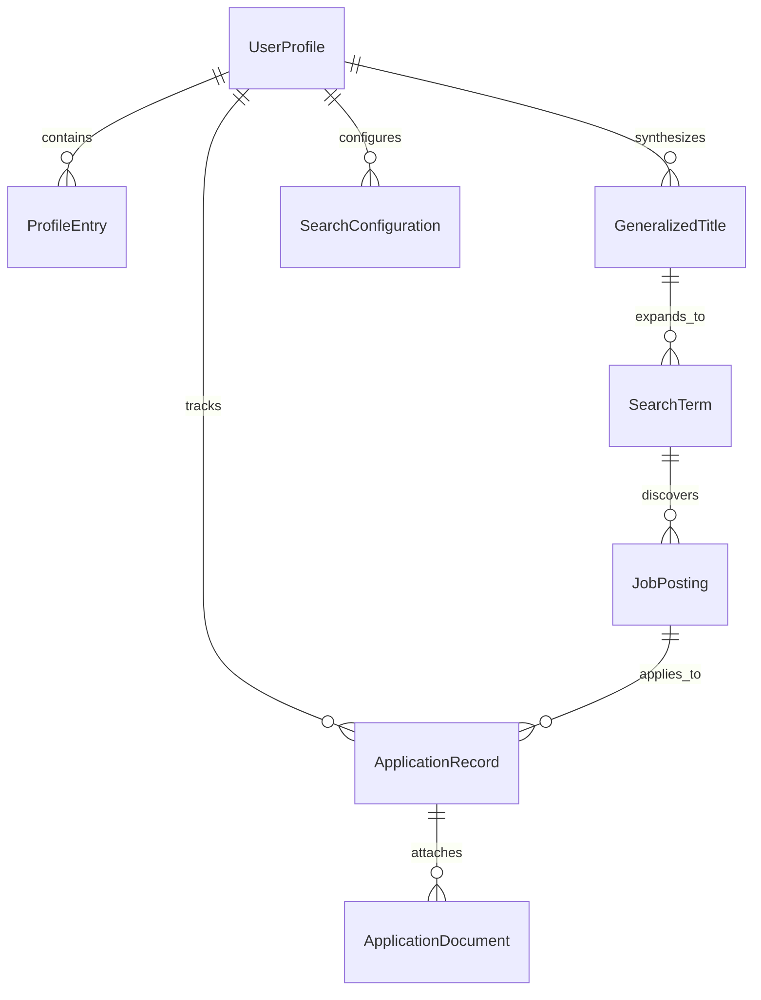

# Database Design Document (Findrr)

- **Document Version:** 1.0.0
- **Status:** Presented for Review (Bootstrap Gate 5)
- **Author:** Senior Software Engineer / Technical Architect / ML Engineer (Findrr AI Pair)
- **Project Owner:** Lebogang Masia
- **Last Updated:** 2026-11-02

---

## 1. Storage Engine & Operational Configuration

Findrr utilizes **SQLite 3** as its primary operational datastore for Milestones 1–3.

### Engine Configuration:
- **Foreign Keys:** Enabled on every database connection (`PRAGMA foreign_keys = ON;`).
- **Journal Mode:** Write-Ahead Logging (`PRAGMA journal_mode = WAL;`) for concurrent read performance.
- **Synchronous Mode:** Normal (`PRAGMA synchronous = NORMAL;`) balancing durability and transaction speed.
- **Encoding:** UTF-8.
- **Default Database File:** `data/findrr.db` (git-ignored, user-permission restricted `0600`).

---

## 2. Entity-Relationship Diagram (ERD)



---

## 3. Relational Schema Definitions

### 3.1 Table: `user_profiles`
Stores top-level profile metadata.
```sql
CREATE TABLE user_profiles (
    id TEXT PRIMARY KEY,                       -- UUID v4
    full_name TEXT NOT NULL,
    email TEXT NOT NULL,
    phone TEXT,
    location TEXT,
    professional_summary TEXT,
    created_at TIMESTAMP NOT NULL DEFAULT CURRENT_TIMESTAMP,
    updated_at TIMESTAMP NOT NULL DEFAULT CURRENT_TIMESTAMP
);
```

### 3.2 Table: `profile_entries`
Stores normalized qualifications, experiences, and skills with explicit provenance tracking.
```sql
CREATE TABLE profile_entries (
    id TEXT PRIMARY KEY,                       -- UUID v4
    profile_id TEXT NOT NULL,                  -- FK -> user_profiles(id)
    category TEXT NOT NULL,                    -- 'EDUCATION', 'EXPERIENCE', 'SKILL', 'CERTIFICATION', 'PROJECT'
    title TEXT NOT NULL,                       -- Degree, Job Title, Skill Name
    organization TEXT,                         -- University, Employer, Issuing Body
    start_date TEXT,                           -- ISO-8601 YYYY-MM
    end_date TEXT,                             -- ISO-8601 YYYY-MM or 'CURRENT'
    description TEXT,                          -- Responsibilities, achievements
    metadata_json TEXT,                        -- Additional structured attributes
    source TEXT NOT NULL,                      -- 'MANUAL', 'RESUME_UPLOAD', 'LINKEDIN', 'GITHUB'
    collection_date TIMESTAMP NOT NULL DEFAULT CURRENT_TIMESTAMP,
    is_verified INTEGER NOT NULL DEFAULT 0,    -- 0: Unverified (extracted), 1: Verified (user-approved)
    FOREIGN KEY (profile_id) REFERENCES user_profiles(id) ON DELETE CASCADE
);
CREATE INDEX idx_profile_entries_cat ON profile_entries(profile_id, category);
```

### 3.3 Table: `generalized_titles`
Stores synthesized primary titles representing user professional suitability.
```sql
CREATE TABLE generalized_titles (
    id TEXT PRIMARY KEY,                       -- UUID v4
    profile_id TEXT NOT NULL,                  -- FK -> user_profiles(id)
    primary_title TEXT NOT NULL,               -- e.g. "Software Developer"
    rationale TEXT NOT NULL,                   -- Justification for the classification
    supporting_skills TEXT NOT NULL,           -- Comma-separated or JSON list of skills
    is_active INTEGER NOT NULL DEFAULT 1,      -- 1: Currently active title for searches
    created_at TIMESTAMP NOT NULL DEFAULT CURRENT_TIMESTAMP,
    FOREIGN KEY (profile_id) REFERENCES user_profiles(id) ON DELETE CASCADE
);
```

### 3.4 Table: `search_configurations`
Stores search preferences and bounds.
```sql
CREATE TABLE search_configurations (
    id TEXT PRIMARY KEY,                       -- UUID v4
    profile_id TEXT NOT NULL UNIQUE,           -- FK -> user_profiles(id)
    target_locations TEXT NOT NULL,            -- JSON array of location strings
    remote_preference TEXT NOT NULL,           -- 'REMOTE', 'HYBRID', 'ON_SITE', 'ANY'
    seniority_level TEXT,                      -- 'ENTRY', 'MID', 'SENIOR', 'LEAD'
    min_compensation REAL,                     -- Minimum desired salary
    currency TEXT DEFAULT 'USD',
    min_results_per_title INTEGER NOT NULL DEFAULT 2,
    max_results_per_title INTEGER NOT NULL DEFAULT 10,
    created_at TIMESTAMP NOT NULL DEFAULT CURRENT_TIMESTAMP,
    updated_at TIMESTAMP NOT NULL DEFAULT CURRENT_TIMESTAMP,
    FOREIGN KEY (profile_id) REFERENCES user_profiles(id) ON DELETE CASCADE,
    CHECK (min_results_per_title >= 2 AND max_results_per_title <= 10 AND min_results_per_title <= max_results_per_title)
);
```

### 3.5 Table: `search_terms`
Stores generated alternative job titles with semantic validation scores.
```sql
CREATE TABLE search_terms (
    id TEXT PRIMARY KEY,                       -- UUID v4
    generalized_title_id TEXT NOT NULL,        -- FK -> generalized_titles(id)
    generated_term TEXT NOT NULL,              -- e.g. "Backend Engineer"
    similarity_score REAL NOT NULL,            -- Cosine similarity from Model 2 [-1.0, 1.0]
    validation_status TEXT NOT NULL,           -- 'ACCEPTED', 'REJECTED_LOW_SCORE', 'REJECTED_DUPLICATE'
    model_version TEXT NOT NULL,               -- Model ID and version used
    created_at TIMESTAMP NOT NULL DEFAULT CURRENT_TIMESTAMP,
    FOREIGN KEY (generalized_title_id) REFERENCES generalized_titles(id) ON DELETE CASCADE
);
CREATE INDEX idx_search_terms_status ON search_terms(generalized_title_id, validation_status);
```

### 3.6 Table: `job_postings`
Stores scraped employment opportunities.
```sql
CREATE TABLE job_postings (
    id TEXT PRIMARY KEY,                       -- UUID v4
    search_term_id TEXT,                       -- FK -> search_terms(id)
    title TEXT NOT NULL,
    company TEXT NOT NULL,
    location TEXT,
    description_text TEXT NOT NULL,
    required_skills_json TEXT,                 -- Extracted keywords
    source_search_url TEXT NOT NULL,           -- Google search result URL
    direct_apply_url TEXT NOT NULL,            -- Resolved employer-authorized ATS/portal URL
    content_hash TEXT NOT NULL UNIQUE,         -- SHA-256(company + title + normalized_description)
    discovered_at TIMESTAMP NOT NULL DEFAULT CURRENT_TIMESTAMP,
    FOREIGN KEY (search_term_id) REFERENCES search_terms(id) ON DELETE SET NULL
);
CREATE INDEX idx_job_postings_comp_title ON job_postings(company, title);
```

### 3.7 Table: `application_records`
Manages application progress lifecycle.
```sql
CREATE TABLE application_records (
    id TEXT PRIMARY KEY,                       -- UUID v4
    profile_id TEXT NOT NULL,                  -- FK -> user_profiles(id)
    posting_id TEXT NOT NULL,                  -- FK -> job_postings(id)
    status TEXT NOT NULL,                      -- 'DISCOVERED', 'SAVED', 'APPLIED', 'INTERVIEWING', 'OFFERED', 'REJECTED', 'WITHDRAWN'
    applied_date TEXT,                         -- ISO-8601 YYYY-MM-DD
    contact_person TEXT,
    contact_email TEXT,
    notes TEXT,
    created_at TIMESTAMP NOT NULL DEFAULT CURRENT_TIMESTAMP,
    updated_at TIMESTAMP NOT NULL DEFAULT CURRENT_TIMESTAMP,
    FOREIGN KEY (profile_id) REFERENCES user_profiles(id) ON DELETE CASCADE,
    FOREIGN KEY (posting_id) REFERENCES job_postings(id) ON DELETE CASCADE,
    UNIQUE(profile_id, posting_id)
);
CREATE INDEX idx_app_status ON application_records(status);
```

### 3.8 Table: `application_documents`
Stores generated tailored CVs, cover letters, and research briefs.
```sql
CREATE TABLE application_documents (
    id TEXT PRIMARY KEY,                       -- UUID v4
    application_id TEXT NOT NULL,              -- FK -> application_records(id)
    doc_type TEXT NOT NULL,                    -- 'TAILORED_CV', 'COVER_LETTER', 'COMPANY_RESEARCH'
    file_format TEXT NOT NULL,                 -- 'PDF', 'DOCX', 'TXT'
    file_path TEXT NOT NULL,                   -- Relative path on local filesystem
    content_hash TEXT NOT NULL,                -- SHA-256 of document content
    created_at TIMESTAMP NOT NULL DEFAULT CURRENT_TIMESTAMP,
    FOREIGN KEY (application_id) REFERENCES application_records(id) ON DELETE CASCADE
);
```

---

## 4. Provenance & Audit Guarantee

To guarantee the **Zero Data Fabrication** invariant:
1. All facts used in tailored documents must originate from `profile_entries` where `is_verified = 1`.
2. The `ApplicationDocument` links to the exact `ApplicationRecord` snapshot, recording the SHA-256 hash of the generated document to preserve reproducibility.
