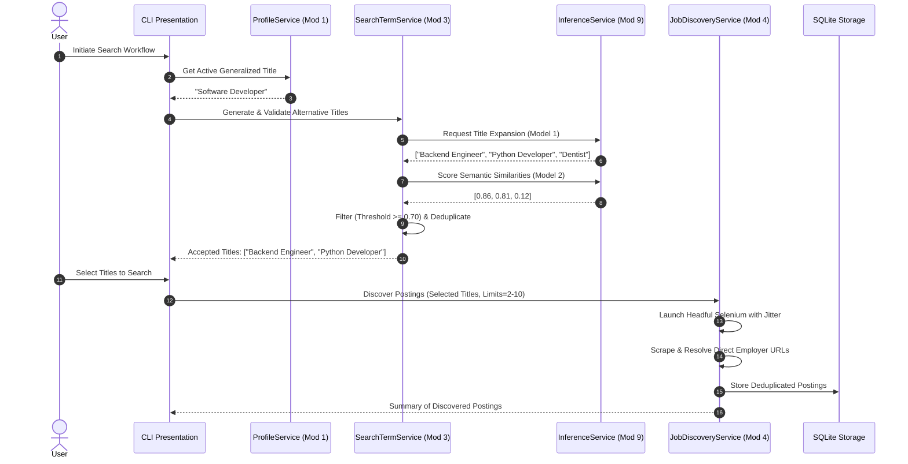
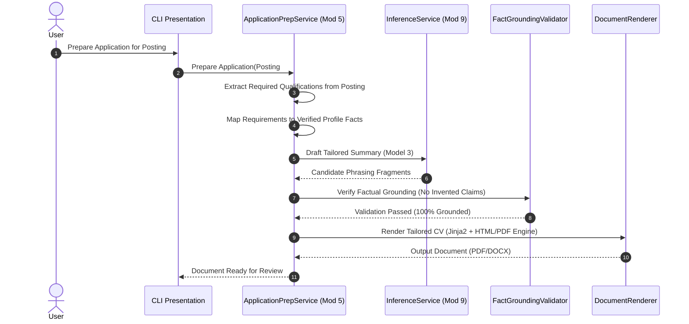

# Software Architecture Document (Findrr)

- **Document Version:** 1.0.0
- **Status:** Presented for Review (Bootstrap Gate 5)
- **Author:** Senior Software Engineer / Technical Architect / ML Engineer (Findrr AI Pair)
- **Project Owner:** Lebogang Masia
- **Last Updated:** 2026-11-02

---

## 1. Architectural Principles & System Overview

Findrr is designed as a **Modular Clean Architecture (Ports & Adapters)** system. It isolates core business rules and data models from user interfaces (CLI in Milestones 1–2; Desktop Web & Mobile in Milestones 3–5), external web drivers (Selenium), and machine learning runtimes (ONNX / PyTorch).

```
+-----------------------------------------------------------------------------------+
|                              PRESENTATION LAYER                                   |
|   CLI Interface (Rich/Click) [M1-M2]  │  Desktop Web & Mobile UI [M3-M5]          |
+---------------------------------------┼-------------------------------------------+
                                        │ (Calls Application Commands/Queries)
                                        ▼
+-----------------------------------------------------------------------------------+
|                              APPLICATION LAYER                                    |
|   ProfileService    │  SearchTermService   │  DiscoveryService   │  AppPrepService|
+---------------------------------------┼-------------------------------------------+
                                        │ (Enforces Business Rules & Invariants)
                                        ▼
+-----------------------------------------------------------------------------------+
|                                DOMAIN LAYER                                       |
|   UserProfile       │  GeneralizedTitle    │  JobPosting         │  Application   |
+---------------------------------------┼-------------------------------------------+
                                        │ (Implemented via Ports/Interfaces)
                                        ▼
+-----------------------------------------------------------------------------------+
|                             INFRASTRUCTURE LAYER                                  |
|   SQLite Storage    │  Selenium Driver     │  Document Generator │  Inference Svc |
|   (SQLAlchemy Core) │  (Headful Google)    │  (Jinja2/Weasyprint)│  (Module 9)    |
+-----------------------------------------------------------------------------------+
```

### Core Invariants Enforced in Architecture:
1. **Zero Data Fabrication:** The document preparation pipeline incorporates a strict assertion layer (`FactGroundingValidator`) that cross-checks all generated bullet points against the user's verified facts.
2. **Discovered != Applied:** The application tracker and discovery services maintain strict workflow boundaries requiring explicit human confirmation before an application state can transition to `Applied`.
3. **Decoupled ML Serving:** Model inference runs exclusively through the centralized `InferenceService` (Module 9). Domain modules never load PyTorch or ONNX sessions directly.
4. **Ethical & Resilient Web Discovery:** Headful Selenium execution is wrapped in rate-limiting interceptors enforcing random delay jitter (2.0s–5.0s) and polite scraping semantics.

---

## 2. Module Boundaries & Decomposition

The system is decomposed into 9 distinct modules matching project requirements:

| Module | Canonical Name | Responsibilities | Core Public Interface |
|---|---|---|---|
| **Module 1** | `onboarding_profile` | Ingestion, normalization, provenance tracking, and generalized title synthesis | `ProfileService` |
| **Module 2** | `search_config` | User preferences, location filters, and search bounds (2–10) | `SearchConfigService` |
| **Module 3** | `search_terms` | Generative title expansion (Model 1) and semantic similarity scoring (Model 2) | `SearchTermService` |
| **Module 4** | `find_postings` | Headful Selenium automation, employer destination link resolution, and deduplication | `JobDiscoveryService` |
| **Module 5** | `application_prep` | Requirement analysis, fact-matching, and tailored CV/cover letter generation | `ApplicationPrepService` |
| **Module 6** | `application_mgmt`| Application lifecycle tracking (Saved -> Applied -> Interviewing -> Offered) | `ApplicationTrackerService` |
| **Module 7** | `dashboard` | Aggregated search, discovery, and application metrics | `DashboardService` |
| **Module 8** | `user_management` | Multi-profile management, active profile selection, and local settings | `UserService` |
| **Module 9** | `model_management`| Artifact loading, SHA-256 verification, and centralized CPU inference service | `InferenceService` |

---

## 3. Component Interaction & Data Flows

### 3.1 Primary Job Discovery Flow (Modules 1 -> 3 -> 4)


### 3.2 Tailored Document Generation Flow (Module 5)


---

## 4. Subsystem Architectures

### 4.1 Web Automation Architecture (`find_postings`)
- **Driver Lifecycle:** `SeleniumDriverFactory` manages single-instance headful Chrome/Chromium sessions using `webdriver.Chrome`.
- **Throttling & Politeness Interceptor:** An internal wrapper injects randomized delays (`time.sleep(uniform(2.0, 5.0))`) before DOM queries and navigation actions.
- **Link Resolution Engine:** For each search result, the system navigates through aggregator redirection links (e.g. Google Jobs, Indeed redirect) to extract and prioritize direct corporate career URLs and Applicant Tracking Systems (e.g. Greenhouse, Lever, Workday).
- **Graceful Failure:** If a portal blocks automation, the driver logs the blocking event, preserves already extracted postings, and skips to the next query without crashing the application.

### 4.2 Document Preparation Architecture (`application_prep`)
- **Deterministic Assembly:** The document layout is controlled entirely by Jinja2 templates for Markdown, HTML, and DOCX structures.
- **Fact-Grounding Layer:** Every bullet point generated by Model 3 is subjected to a strict containment assertion: all named entities, technologies, institutions, and job titles must exist in the user's verified profile data.
- **Multi-Format Exporters:**
  - *DOCX Exporter:* Uses `python-docx` for editable, ATS-friendly resumes.
  - *PDF Exporter:* Uses `weasyprint` or `reportlab` for professionally styled output.

### 4.3 Centralized Machine Learning Serving (`model_management`)
- **Engine Placement:** Local CPU execution via ONNX Runtime (`CPUExecutionProvider`) and PyTorch CPU.
- **Thread Capping:** Restricts internal multi-threading (`intra_op_num_threads=4`) to prevent starvation of the operating system.
- **Integrity Validation:** Every artifact bundle in `models/<model_id>/<version>/` is verified against `manifest.json` via SHA-256 before instantiation.
- **Resource Lifecycle:** The `ModelManager` provides explicit `unload_model(model_id)` routines so memory is reclaimed when switching between search and document generation.

---

## 5. Security & Privacy Architecture

- **Local Storage Sandbox:** All user profile data, credentials, and job search records reside in local SQLite files stored with user-only permissions (`chmod 600`).
- **Secret Zero-Exposure:** No hardcoded tokens, passwords, or cloud credentials exist in code. Configuration is injected via environment variables (`.env`).
- **HTML Sanitization:** Raw web pages scraped from external job sites are passed through `bleach` and `BeautifulSoup` to strip scripts, iframes, and active content before parsing.

---

## 6. Technology Stack & Dependencies

- **Language:** Python 3.11+ (Host runs Python 3.14.8).
- **Core Frameworks:** Pydantic v2 (Data Validation), SQLAlchemy 2.0 Core / SQLite3 (Storage).
- **Web Automation:** Selenium 4.x, BeautifulSoup4.
- **Machine Learning:** ONNX Runtime, Hugging Face Transformers, Sentence-Transformers.
- **Document Generation:** Jinja2, python-docx, WeasyPrint / ReportLab.
- **Testing:** Pytest, Pytest-Cov.
- **Code Quality:** Ruff, Gitleaks.
